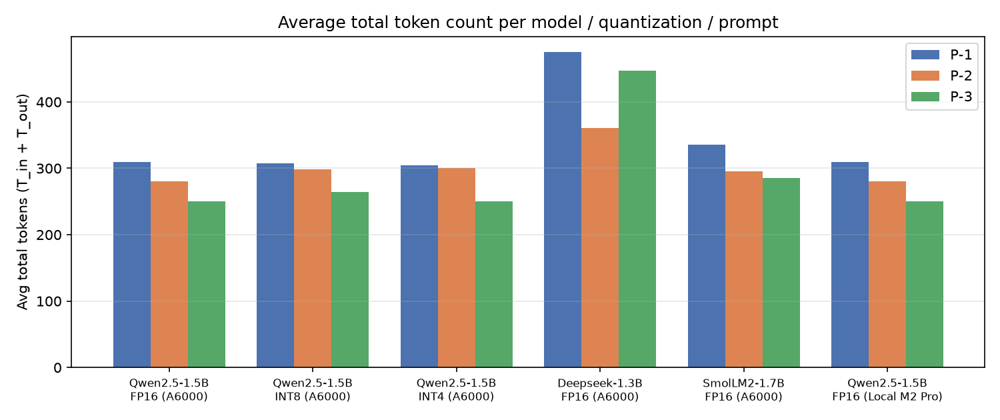
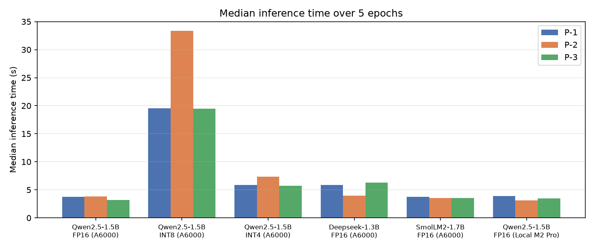

# 1. Experimental setup

| Item | Details |
|---|---|
| Task | Generate a Google-style docstring for `below_zero` and return the complete function |
| Models (3 SLMs) | **Qwen2.5-Coder-1.5B-Instruct**, **Deepseek-Coder-1.3B-Instruct**, **SmolLM2-1.7B-Instruct** |
| Quantization (Qwen2.5-Coder-1.5B) | Unquantized **FP16**; **INT8** (bitsandbytes LLM.int8); **INT4** (bitsandbytes NF4, FP16 compute) |
| Cloud hardware | NVIDIA RTX A6000 48 GB (rented Vast.ai instance, used in place of Colab), PyTorch 2.14 / CUDA 13, Transformers 5.21 |
| Local hardware | Apple **M2 Pro** laptop, 16 GB unified memory, PyTorch MPS backend (Qwen FP16, all prompts) |
| Runs | 5 models/quant configs × 3 prompts × 5 epochs on the GPU (75 runs) + 15 local runs = **90 runs** |
| Decoding | Greedy, `max_new_tokens=512`, batch 1, one untimed warm-up per model |
| Metrics | T_in / T_out from the official tokenizer (chat template included); `time.perf_counter()` around `generate()` with device sync; GPU energy from the NVML board energy counter |
| Accuracy (P/F) | Automatic checker, then manual review of every unique output. **P** = valid Python; docstring *inside* the function; body unchanged; behaviour unchanged on 6 test inputs; documents `operations` (Args/Parameters) and the bool return; any doctest examples correct |

**Efficiency ratio (ER)** = accuracy rate ÷ average T_total × 1000, i.e. correct docstrings per 1,000 tokens processed.

## Summary of results (mean of 5 epochs; GPU unless noted)

| Model | Quant | Prompt | T_in | T_out | **T_total** | Time median (s) | Time SD (s) | GPU energy median (J) | Acc. | ER |
|---|---|---|---|---|---|---|---|---|---|---|
| Qwen2.5-Coder-1.5B | FP16 | P-1 | 185 | 124 | 309 | 3.73 | 1.501 | 395 | 0/5 | 0.00 |
| Qwen2.5-Coder-1.5B | FP16 | **P-2** | 151 | 129 | **280** | **3.82** | 0.040 | **399** | **5/5** | **3.57** |
| Qwen2.5-Coder-1.5B | FP16 | P-3 | 142 | 108 | 250 | 3.16 | 0.018 | 338 | 0/5 | 0.00 |
| Qwen2.5-Coder-1.5B | INT8 | P-1 | 185 | 122 | 307 | 19.52 | 4.908 | 1567 | 0/5 | 0.00 |
| Qwen2.5-Coder-1.5B | INT8 | P-2 | 151 | 147 | 298 | 33.35 | 15.950 | 2623 | 5/5 | 3.36 |
| Qwen2.5-Coder-1.5B | INT8 | P-3 | 142 | 122 | 264 | 19.46 | 20.782 | 1579 | 5/5 | 3.79 |
| Qwen2.5-Coder-1.5B | INT4 | P-1 | 185 | 119 | 304 | 5.90 | 0.201 | 527 | 0/5 | 0.00 |
| Qwen2.5-Coder-1.5B | INT4 | P-2 | 151 | 149 | 300 | 7.32 | 7.349 | 666 | 5/5 | 3.33 |
| Qwen2.5-Coder-1.5B | INT4 | P-3 | 142 | 108 | 250 | 5.70 | 0.444 | 504 | 0/5 | 0.00 |
| Deepseek-Coder-1.3B | FP16 | P-1 | 237 | 238 | 475 | 5.89 | 0.177 | 627 | 5/5 | 2.11 |
| Deepseek-Coder-1.3B | FP16 | P-2 | 203 | 158 | 361 | 3.95 | 0.047 | 416 | 0/5 | 0.00 |
| Deepseek-Coder-1.3B | FP16 | P-3 | 190 | 257 | 447 | 6.28 | 0.101 | 677 | 5/5 | 2.24 |
| SmolLM2-1.7B | FP16 | P-1 | 186 | 150 | 336 | 3.76 | 0.076 | 443 | 5/5 | 2.98 |
| SmolLM2-1.7B | FP16 | P-2 | 152 | 143 | 295 | 3.54 | 0.037 | 411 | 5/5 | 3.39 |
| SmolLM2-1.7B | FP16 | P-3 | 140 | 145 | 285 | 3.55 | 0.063 | 427 | 5/5 | 3.51 |
| Qwen2.5-Coder-1.5B (M2 Pro) | FP16 | P-1 | 185 | 124 | 309 | 3.86 | 1.012 | n/a | 0/5 | 0.00 |
| Qwen2.5-Coder-1.5B (M2 Pro) | FP16 | P-2 | 151 | 129 | 280 | 3.14 | 1.558 | n/a | 5/5 | 3.57 |
| Qwen2.5-Coder-1.5B (M2 Pro) | FP16 | P-3 | 142 | 108 | 250 | 3.46 | 2.086 | n/a | 0/5 | 0.00 |

Per-prompt averages over all GPU configurations: **P-1** 346.2 tokens, 40 % accuracy, ER 1.16. **P-2** 306.8 tokens, 80 % accuracy, ER 2.61. **P-3** 299.2 tokens, 60 % accuracy, ER 2.01. All 90 raw rows are in `results/experimental_matrix.xlsx` and `results/experimental_matrix_all.csv`.

# 2. Green Engineering Justification

## 2.1 Optimal prompt design for green inference

**P-3 gave the lowest average total token count**: 299.2 tokens, against 306.8 for P-2 and 346.2 for P-1. It was the cheapest prompt for 4 of the 5 configurations. P-3 saves about 43 input tokens versus P-1. The exception is Deepseek-Coder. Its P-3 reply opened with "Here is the corrected code" and ended with a paragraph of explanation, so T_out grew to 257 tokens and the total to 447. A shorter prompt does not guarantee a shorter answer.

**P-2 gave the best efficiency ratio**: 2.61 correct outputs per 1,000 tokens, against 2.01 for P-3 and 1.16 for P-1. Its accuracy was 80 % against 60 % and 40 %. P-3's token savings were often a false economy. Qwen FP16 and INT4 answered P-3 by returning the original prose docstring with no Args or Returns sections. The polite, verbose P-1 was worst on both counts. For Qwen it caused a docstring placed *above* the function at module level, which is not a docstring of the function at all.

## 2.2 Impact of quantization and hardware

For Qwen2.5-Coder-1.5B with P-2, every quantization level stayed accurate (5/5), but neither quantized version was faster:

- **FP16:** median 3.82 s and 399 J per inference.
- **INT4 (NF4):** 7.32 s and 666 J, about 1.9× slower.
- **INT8:** 33.35 s and 2,623 J, about 9× slower.

**FP16 (unquantized) was the best level: the lowest inference time with no loss of accuracy.**

The reason is that a 1.5B model in FP16 takes only about 3 GB of a 48 GB GPU. Single-request decoding is limited by kernel-launch overhead, not by memory bandwidth. bitsandbytes adds de-quantization work to every matrix multiply, and INT8 adds its outlier-decomposition step as well. Those costs are paid without any bandwidth saving in return. Quantization's real benefit here is memory footprint, not speed or energy.

Quantization also changed the greedy decoding path. INT8 rewrote the docstring for P-3 and passed, while FP16 and INT4 did not. Quantized models are not output-equivalent to the original.

**Local (M2 Pro) vs cloud (A6000).** Qwen FP16 produced byte-identical text on both devices for every prompt. Median latency was similar: 3.14 s on the M2 Pro and 3.82 s on the A6000 for P-2. Batch-1 generation of a small model leaves the A6000's compute almost idle. The A6000 board used about 400 J per docstring, an average draw of about 105 W.

On-device power could not be measured on the Mac, because `powermetrics` requires root. As an estimate, assuming a typical 15–30 W package draw during MPS inference, each docstring would use about 50–100 J. That is roughly **4–8× less energy per inference** than the cloud GPU at the same latency. **For single small-model requests, the laptop is the greener choice**, although the local figure is an estimate and the GPU figure is measured.

## 2.3 Model robustness and determinism

T_out variance was **zero for all 18 combinations**. With greedy decoding, all five epochs produced byte-identical outputs, and accuracy was therefore stable as well. Only wall-clock time varied.

- **Most deterministic:** Qwen2.5-Coder FP16 + P-3 on the A6000 (SD 0.018 s, coefficient of variation 0.6 %). Among the accurate combinations, SmolLM2 FP16 + P-2 (SD 0.037 s) and Qwen FP16 + P-2 (SD 0.040 s) were the most stable, both with a CV of about 1 %.
- **Least stable:** the bitsandbytes variants, with SD up to 20.8 s for INT8 and 7.3 s for INT4 P-2. Individual epochs jumped from about 19 s to 58–69 s while the shared cloud host showed a load average of about 12. CPU-heavy quantized kernels amplify noise from other workloads on the host. The laptop was also noisy (CV 24–48 %) because it was being used interactively during the runs.

Green metrics should therefore be reported as medians, not only means.

## 2.4 Overall green recommendation

**Qwen2.5-Coder-1.5B-Instruct, unquantized FP16, with prompt P-2:**

- **Accuracy:** 100 % (5/5) on both devices.
- **Tokens:** the lowest total (280) of any combination with full accuracy.
- **Speed and energy:** a median of 3.82 s and 399 J on the A6000, the lowest energy of any fully accurate GPU combination.
- **Efficiency:** the highest practical ER (3.57).
- **Stability:** a CV of about 1 %.

INT8 + P-3 scored a slightly higher ER (3.79), but it needed **4×** the energy (1,579 J). SmolLM2 + P-2 is a close alternative: 295 tokens, 3.54 s and 411 J. For the lowest energy overall, run the same configuration locally on the M2 Pro.
