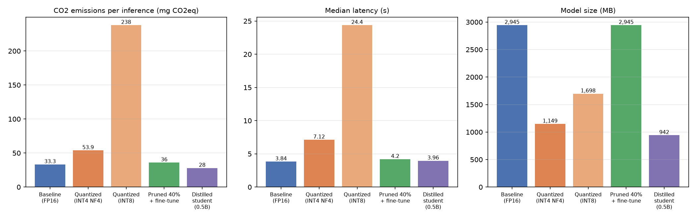
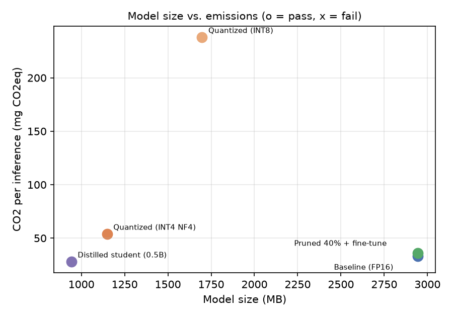

**Code repository:** <https://github.com/ahmd-nish/ensf619-assignments/tree/main/Assignment_2> (see `Assignment_2/README.md` to reproduce the results).

# 1. Summary table

Task: generate a Google-style docstring for `below_zero` (identical to Assignment 1), using prompt **P-2**, the best prompt in Assignment 1. Each model was run for **5 epochs**. A **new CodeCarbon `EmissionsTracker` was started right before and stopped right after every inference run**. CO₂ and latency are per inference, as the mean of the 5 runs.

| Model version | Technique | CO₂ per inference (mg CO₂eq) | Δ CO₂ vs baseline | Energy per inference (J) | Latency, mean / median (s) | Model size (MB) | Δ size | Accuracy (P/F) |
|---|---|---|---|---|---|---|---|---|
| **1. Baseline** (FP16) | None | **33.28** ± 0.59 | — | 498 | 3.86 / 3.84 | 2,944.5 | — | **P** (5/5) |
| **2. Quantized** (4-bit NF4) | Quantization | **53.93** ± 0.79 | +62 % | 807 | 7.15 / 7.12 | 1,148.6 | −61 % | **P** (5/5) |
| 2b. Quantized (8-bit), extra | Quantization | 238.04 ± 104.3 | +615 % | 3,562 | 36.82 / 24.39 | 1,697.6 | −42 % | P (5/5) |
| **3. Pruned** (40 % unstructured + fine-tune) | Pruning | **36.01** ± 2.42 | +8 % | 539 | 4.38 / 4.20 | 2,944.5 dense (≈2,101 sparse\*) | 0 % (≈−29 %\*) | **P** (5/5) |
| **4. Distilled** (0.5B student) | Knowledge distillation | **28.02** ± 0.33 | **−16 %** | **419** | 3.93 / 3.97 | **942.4** | **−68 %** | **P** (5/5) |
| *ref: pruned 40 %, no fine-tune* | ablation | 55.65 | +67 % | 833 | 6.78 / 6.80 | 2,944.5 | 0 % | F (0/5) |
| *ref: 0.5B student before KD* | ablation | 20.26 | −39 % | 303 | 2.73 / 2.74 | 942.4 | −68 % | F (0/5) |

Notes on the table:

- ± is the standard deviation over the 5 runs.
- Model size is the serialized `state_dict`, measured with the provided `get_model_size` function. That function reports MiB.
- \* The pruned model is stored densely: the zeros still take space. The value in brackets is the estimated size if the 1,019.6 M non-zero FP16 values were stored with a 1-bit mask over the 1,310 M pruned weights.
- All runs used an NVIDIA RTX A6000 48 GB in Bucharest, Romania. CodeCarbon used a grid carbon intensity of 240.6 g CO₂/kWh.
- **Held-out check:** a broader accuracy check ran each model once on 33 unseen HumanEval functions. Pass counts: baseline 5/33, INT4 5/33, INT8 4/33, pruned + fine-tune 27/33, distilled 12/33, pruned without fine-tune 2/33, student before KD 1/33. Section 3.3 discusses the jump for the two fine-tuned models.

# 2. Implementation details

**Chosen SLM (baseline and teacher):** Qwen2.5-Coder-1.5B-Instruct, 1.54 B parameters, run in FP16 on CUDA. It was the most accurate model in Assignment 1 and shares its tokenizer with a smaller sibling model, which makes logit-level distillation possible. Decoding was greedy with `max_new_tokens=512`, and each model had one untimed warm-up run.

**Quantization:** bitsandbytes post-training weight quantization, loaded with `BitsAndBytesConfig`:

- **4-bit NF4**, the primary model 2: `load_in_4bit`, `bnb_4bit_quant_type="nf4"`, FP16 compute.
- **8-bit LLM.int8()**, an extra row (2b), reported because Assignment 1 also tested it.

No calibration or retraining was needed. The 4-bit `state_dict` packs two weights per byte, which is why it reports 889 M stored "parameters".

**Pruning (40 % unstructured):**

- **Method:** `torch.nn.utils.prune.l1_unstructured` with `amount=0.4`, applied to every `nn.Linear` in the 28 transformer blocks (196 layers: q, k, v, o, gate, up and down projections). The 40 % of weights with the smallest magnitude in each layer were set to zero. The tied embedding and LM head were left dense. The result is 40.0 % sparsity in the pruned layers and 33.9 % of all parameters.
- **Recovery fine-tune:** full-parameter AdamW, learning rate 1e-5, batch 8, 2 epochs (224 steps), with bf16 autocast and FP32 master weights. The binary masks were re-applied after every optimizer step, and the final sparsity was verified at exactly 40 %. Loss fell from 0.148 to 0.033.

**Knowledge distillation:**

- **Teacher and student:** the FP16 baseline Qwen2.5-Coder-1.5B, frozen, teaching **Qwen2.5-Coder-0.5B-Instruct** (0.49 B parameters, 3.1× smaller, same 151,936-token vocabulary).
- **Loss:** α·T²·KL(teacher‖student) at temperature T = 2, plus (1−α)·cross-entropy on the teacher-written tokens, with α = 0.5. The loss was computed on response tokens only.
- **Training:** AdamW, learning rate 2e-5, batch 8, 3 epochs (336 steps). KL fell from 0.96 to 0.28 and cross-entropy from 0.165 to 0.042.

**Training data:** the same data was used for the pruning fine-tune and for distillation. The teacher generated docstrings for:

- the HumanEval training split, under all three Assignment 1 prompts, and
- 974 MBPP functions, using P-2. Each MBPP function's task description was inserted as a plain prose docstring, so the input matches the assignment's input format.

Only outputs that passed the same checker used for P/F grading were kept: 892 of 1,364. **HumanEval/3 (`below_zero`) and the 33 held-out functions were never used for training.**

**CodeCarbon setup:** v3.3.2, with `EmissionsTracker(measure_power_secs=1, tracking_mode="process")` started and stopped around each `generate()` call. GPU power comes from NVML and is measured; it is about 85 % of total energy. The container exposes no RAPL interface, so CodeCarbon estimates CPU power (about 8 W) and RAM power (10 W).

# 3. Comparative analysis

## 3.1 Which technique achieved the lowest CO₂ emissions?

**Knowledge distillation achieved the lowest emissions: 28.0 mg CO₂eq per inference, 16 % below the 33.3 mg baseline.** It did so even though the student wrote longer answers (151 against 129 output tokens). Its energy per generated token was 2.8 J, against 3.9 J for the baseline.

Pruning came second at 36.0 mg, 8 % above the baseline. 4-bit quantization came last at 53.9 mg, 62 % above the baseline. The 8-bit variant was far worse at 238 mg. The untrained 0.5B student emitted even less (20.3 mg) but failed the task, so it does not count.

## 3.2 Relationship between model-size reduction and CO₂ reduction

**Smaller files did not mean lower emissions.** Of the three techniques, the two that shrank the model on disk the most were not the greenest:

- **4-bit quantization:** 61 % smaller, but 62 % *more* CO₂.
- **8-bit quantization:** 42 % smaller, but more than 7× the emissions.

bitsandbytes stores the weights compactly but de-quantizes them inside every matrix multiply. A 1.5 B model generating one request at a time on a 48 GB GPU is limited by kernel-launch overhead, not by memory bandwidth. Quantization therefore adds compute and time (7.1 s and 24.4 s against 3.8 s) without saving anything that mattered for this workload.

**Unstructured pruning** removed 34 % of the parameters but saved neither storage nor energy. The zeros are still stored in dense tensors and still multiplied by dense GPU kernels. Emissions rose slightly (+8 %) because the pruned model generated 9 more tokens.

**Only distillation reduced the actual compute per token.** The student has 3.1× fewer parameters and 24 layers against 28, which cut size by 68 % and CO₂ by 16 %. The emissions saving is much smaller than the size saving because single-request decoding is dominated by fixed per-token overhead.

In short, **CO₂ follows the work actually executed on the hardware, not the bytes on disk.** Size reduction only pays off when the runtime can exploit it: real 4-bit kernels for quantization, sparse or 2:4 structured kernels for pruning, or a genuinely smaller architecture for distillation.

{width=62%}

## 3.3 Best environmental-performance trade-off

**Knowledge distillation gives the best trade-off:**

- the lowest emissions of any passing model (−16 % CO₂, −16 % energy),
- a 68 % smaller model,
- the same latency (3.9 s),
- P/F accuracy kept on all 5 runs, with byte-identical output every run.

The ablations show that both recovery steps were essential. Without distillation, the raw 0.5B student failed (0/5): its docstring had no Args or Returns sections. Without the recovery fine-tune, the pruned model failed (0/5) and also produced 68 % more tokens and emissions.

Distillation cost 7.8 mg CO₂ per inference more than the raw student, which is the price of turning a failing model into a passing one.

One caveat applies to the held-out figures. The pruned (27/33) and distilled (12/33) models beat the baseline (5/33) because their training data consisted only of teacher outputs that passed the checker. The training therefore also aligned them to the required Google docstring format. This is a benefit of the recovery and distillation training, not of compression itself. The untrained ablations (2/33 and 1/33) show that compression on its own reduced quality.

## 3.4 Difficulty of implementation

1. **Quantization was the easiest.** It needs one `BitsAndBytesConfig` argument, no data and no training, and was ready in minutes. However, it depends on hardware and libraries: bitsandbytes needed CUDA and could not be used on the Apple-silicon laptop from Assignment 1. Whether it saves energy depends entirely on kernel quality, and here it did not.
2. **Pruning was moderate.** Zeroing the weights takes a few lines of `torch.nn.utils.prune`. Recovering accuracy, however, required:
   - a labelled fine-tuning set,
   - a training loop that keeps the masks fixed, and
   - full fine-tuning of a 1.5 B model, which needs about 25 GB of GPU memory for FP32 weights and Adam state.

   Turning the sparsity into real savings would need sparse storage formats, structured (2:4) pruning or sparse kernels. Plain PyTorch provides none of these.
3. **Distillation was the hardest.** It needed:
   - a student with a compatible tokenizer,
   - a transfer set (the teacher generated 1,364 answers, of which 892 were kept after filtering),
   - teacher and student held in GPU memory together,
   - a custom KL plus cross-entropy loss, and
   - tuning of α and the temperature.

   It also has a one-time training footprint. On the A6000 the training took about 5 minutes of GPU time. The estimated upper bound is about 25 Wh, or about 6 g CO₂; this was not measured. That cost is repaid after roughly 1,100 inferences. It was the most work, but it was the only technique that gave a real environmental gain for this task.

**Overall:** for small code models served one request at a time, distillation into a smaller architecture is the greenest compression option. Quantization should only be used where efficient low-bit kernels exist, and unstructured pruning should be used only together with sparse-aware storage and kernels.
